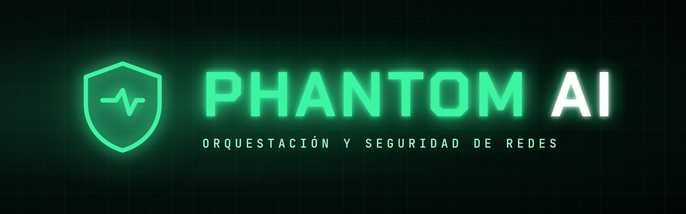
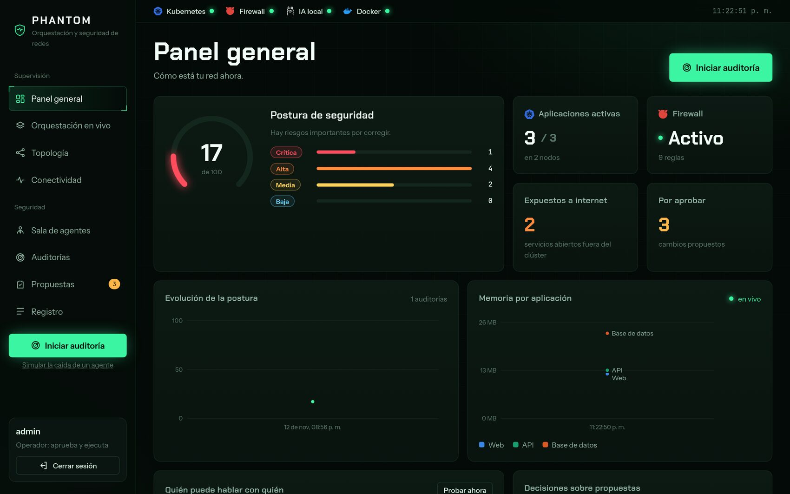
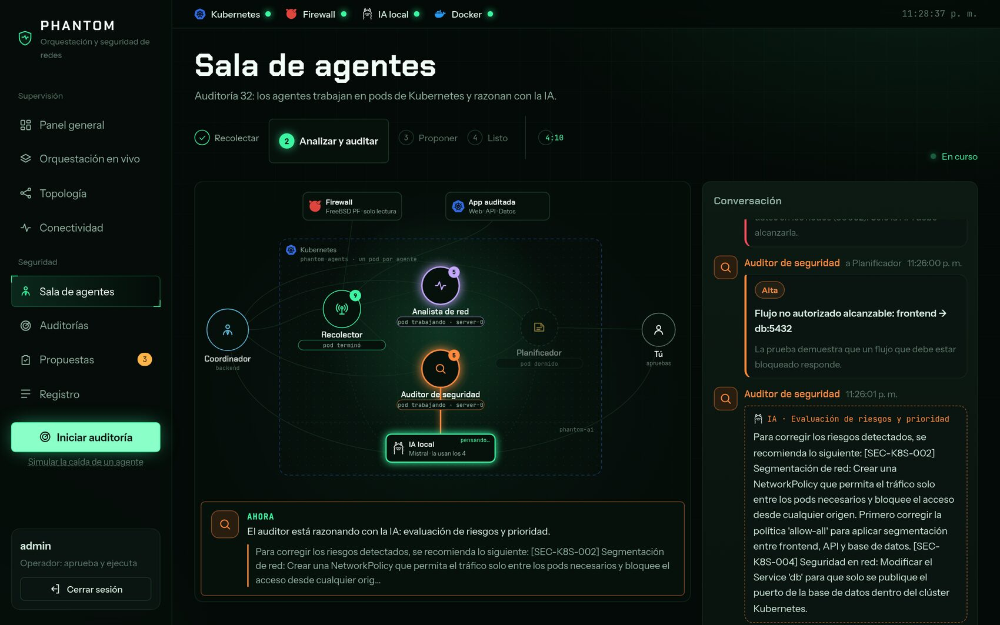
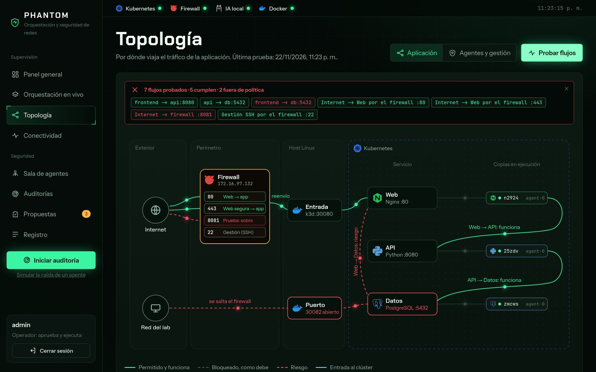
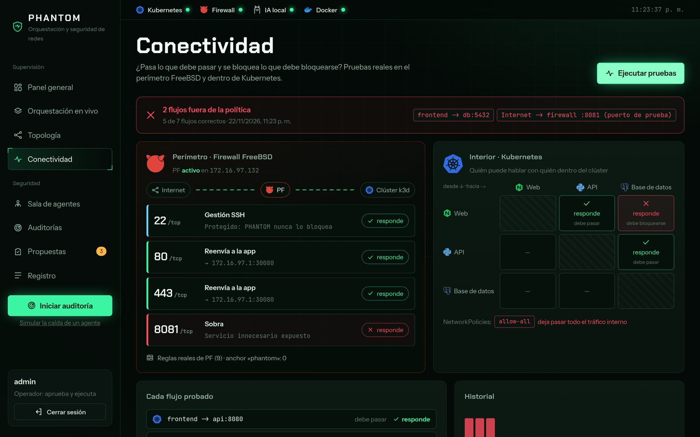
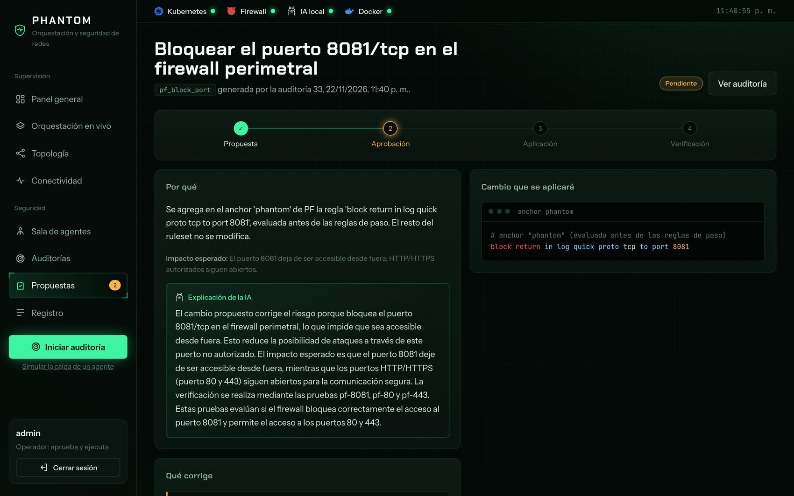
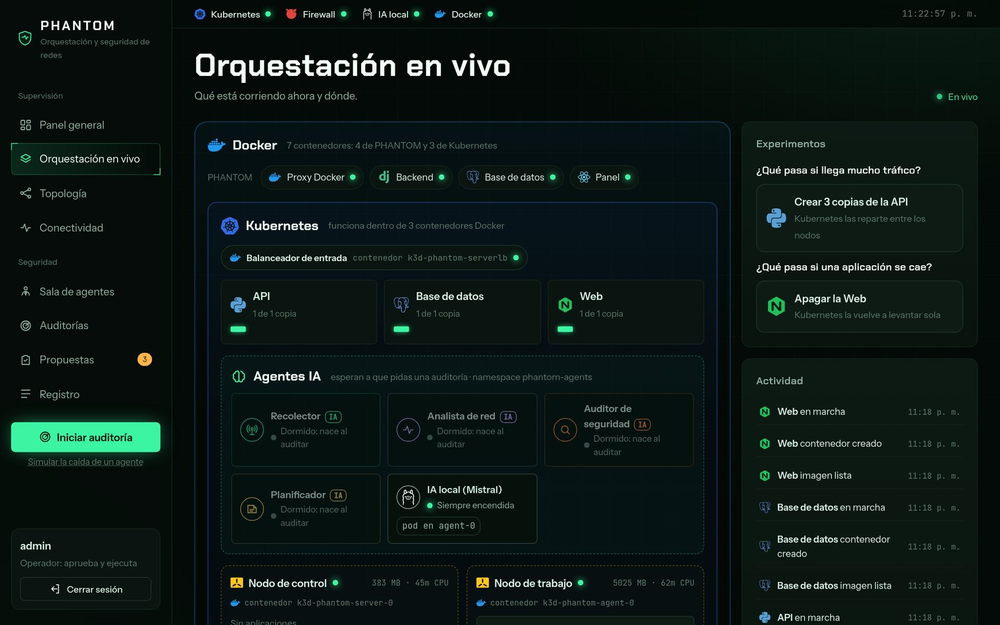

<p align="center">
  
</p>

<p align="center">
  
  
  
  
  
  
  
</p>

<p align="center"><b>Cuatro agentes de IA revisan un clúster Kubernetes y un firewall FreeBSD, encuentran riesgos y proponen cómo corregirlos.<br>Nada cambia sin la aprobación de una persona.</b></p>

---

## Video:


https://github.com/user-attachments/assets/31fe8ad6-d97c-4719-b385-e39f37c612fa


## Manual de usuario

**[Manual de PHANTOM AI (PDF, 36 páginas)](docs/manual/Manual_PHANTOM_AI.pdf)**: explica el sistema en lenguaje sencillo, pantalla por pantalla y con capturas reales. Está pensado para cualquier persona, aunque nunca haya administrado una red.

---

## Índice

1. [Qué es PHANTOM AI](#qué-es-phantom-ai)
2. [Capturas](#capturas)
3. [Arquitectura](#arquitectura)
4. [Instalación paso a paso](#instalación-paso-a-paso)
5. [Uso diario](#uso-diario)
6. [Guion de demostración](#guion-de-demostración)
7. [Comandos](#comandos)
8. [Estructura del repositorio](#estructura-del-repositorio)
9. [Seguridad del diseño](#seguridad-del-diseño)
10. [Solución de problemas](#solución-de-problemas)
11. [Pruebas](#pruebas)

---

## Qué es PHANTOM AI

Plataforma multiagente para la orquestación inteligente y la seguridad de redes (proyecto de **Redes II**).

PHANTOM revisa dos cosas: un **clúster Kubernetes** con una aplicación de tres capas (web, API, base de datos) y un **firewall FreeBSD con PF** que protege la entrada. Lo hace con cuatro agentes de **IA híbrida**: las reglas fijas detectan y deciden, y el modelo local (Ollama `mistral`, que corre dentro del clúster) razona y explica. Lo que diga la IA nunca cambia un hallazgo ni una corrección. Hay una prueba que lo garantiza: si la IA responde algo absurdo, los resultados son idénticos.

**Kubernetes orquesta a los agentes.** Cada uno corre en su propio pod, nace cuando pides una auditoría y desaparece al terminar.

| Agente | Reglas fijas (deciden) | IA (razona y explica) |
|---|---|---|
| **Recolector** | Lee el clúster (RBAC de solo lectura) y el firewall (llave SSH de solo lectura); prueba los flujos de red | Interpreta la red: por dónde entra el tráfico, qué está expuesto, qué responde |
| **Analista** | Detecta fallos operativos (pods caídos, reinicios, servicios sin endpoints) | Diagnostica la causa probable y a qué servicio afecta |
| **Auditor** | Detecta riesgos de seguridad (`SEC-K8S-*`, `SEC-PF-*`, `SEC-NET-*`) | Explica cómo se aprovecharía cada riesgo y en qué orden corregirlo |
| **Planificador** | Arma las correcciones con operaciones permitidas | Explica por qué cada cambio corrige el riesgo y cómo se verifica |

Un **controlador seguro** solo aplica operaciones de una lista permitida. Antes de aplicar exige aprobación humana y guarda un respaldo. Después verifica con pruebas de conectividad y revierte solo si alguna falla.

### El ciclo

```
Recolecta → Analiza ‖ Audita → Propone → Tú apruebas → Aplica → Verifica (y revierte si algo falla)
```

### Operaciones que puede aplicar

| Operación | Efecto | Verificación |
|---|---|---|
| `k8s_apply_segmentation` | default-deny, más frontend→api:8080 y api→db:5432; elimina la política `allow-all` | `fe-api` ✓, `api-db` ✓, `fe-db` bloqueado |
| `k8s_service_to_clusterip` | Retira el NodePort de la base de datos | `api-db` ✓ |
| `pf_block_port` | `block return in log quick proto tcp to port N` en el anchor `phantom` | puerto N bloqueado, 80/443 abiertos |

El puerto 22 y los autorizados (`PHANTOM_PF_ALLOWED_PORTS`) nunca se pueden bloquear.

---

## Capturas

| Panel general | Sala de agentes (en vivo) |
|---|---|
|  |  |
| **Topología** | **Conectividad** |
|  |  |
| **Propuesta con explicación de la IA** | **Orquestación en vivo** |
|  |  |

---

## Arquitectura

```
Usuario ─► React (Vite) ─► Django REST ─┬─► PostgreSQL
                                        ├─► Coordinador ──crea Jobs──► Kubernetes (k3d)
                                        │      ▲                        ├─ phantom-agents: recolector ─► (analista ‖ auditor) ─► planificador
                                        │      └─ API de agentes ◄──────┤     (un pod por agente; RBAC mínimo; NetworkPolicy default-deny)
                                        │         172.18.0.1:8001       └─ phantom-ai: Ollama (mistral, CPU)
                                        └─► Controlador seguro ─┬─► kubectl ─► namespace phantom-demo (app auditada)
                                                                └─► SSH forzado ─► FreeBSD /usr/local/sbin/phantom-pf ─► PF anchor "phantom"
```

### Ruta del tráfico

```
Internet ──► FreeBSD PF :80/:443 ──rdr+nat──► host Linux :30080 (entrada k3d) ──► Service Web ──► API ──► Datos
Red del lab ──────────────────────────────► host :30082 (solo si la BD queda como NodePort: se salta el firewall)
```

### Dónde corre cada cosa

| Pieza | Dónde | Por qué |
|---|---|---|
| Agentes (4) | **Jobs de Kubernetes** en `phantom-agents`, uno por agente y por auditoría | Kubernetes los programa, los reintenta si caen (`backoffLimit: 1`), los mata si se pasan de tiempo y los borra a los 10 min |
| IA (Ollama + mistral) | **Deployment** en `phantom-ai`, siempre encendido | El modelo queda cargado en memoria; solo los agentes pueden hablarle |
| Coordinador, controlador, API, BD, panel | Docker Compose en el host | Vigilan y corrigen el clúster desde fuera: si el clúster falla, el que lo vigila sigue vivo |
| App auditada | `phantom-demo` en Kubernetes | Estado inseguro **deliberado** para la demo |
| Firewall | VM FreeBSD 14 con PF | Perímetro real, administrado solo por un canal SSH restringido |

### Estado inseguro deliberado (para la demo)

- La base de datos está publicada como NodePort `30082`, así que se salta el firewall.
- La NetworkPolicy `allow-all` deja que la web hable directamente con la base de datos.
- El puerto `8081` está abierto en PF sin necesidad.

---

## Instalación paso a paso

> Probado en **Ubuntu 24.04/25.x** con **VMware Workstation 17**. Con VirtualBox también funciona (ver la nota del paso 4).

### 1. Requisitos del equipo

| Necesitas | Para qué | Cómo comprobarlo |
|---|---|---|
| Linux x86_64, **16 GB de RAM** recomendados | k3d + Ollama + VM | `free -h` |
| **Docker Engine** nativo + plugin Compose, con tu usuario en el grupo `docker` | plataforma y clúster k3d | `docker compose version` |
| **VMware Workstation** (o VirtualBox) | VM del firewall FreeBSD | `vmrun -T ws list` |
| **Ollama** instalado en el host con el modelo `mistral` | se copia al clúster sin volver a descargarlo | `ollama list` |
| `make`, `git`, `curl`, `ssh`, `nc` | scripts del proyecto | `make --version` |
| Una llave SSH personal (`~/.ssh/id_ed25519`) | administrar la VM la primera vez | `ls ~/.ssh/id_ed25519` |
| Python 3.12+ y Node 18+ (solo para desarrollo y pruebas) | `make test`, `make frontend` | `python3 --version` |

```bash
# Ollama + modelo (unos 4 GB)
curl -fsSL https://ollama.com/install.sh | sh
ollama pull mistral

# Llave SSH personal, si no tienes una
ssh-keygen -t ed25519
```

> **Docker Desktop no sirve si usas VMware:** se cae (QEMU abort) con las VMs encendidas. Usa Docker Engine nativo. El proyecto ya trae `bin/phx`, que fuerza el socket nativo y su propio `KUBECONFIG`.

### 2. Clonar y configurar

```bash
git clone https://github.com/SergiusYT/Phantom-IA.git
cd Phantom-IA
cp .env.example .env
```

Edita `.env` y cambia **como mínimo** `PHANTOM_SECRET_KEY` (una cadena larga aleatoria) y `PHANTOM_DB_PASSWORD`. Si tu VM tendrá otra IP, cámbiala en `PHANTOM_PF_HOST`.

```bash
make tools      # descarga kubectl y k3d en bin/
```

### 3. Crear la VM del firewall (FreeBSD)

1. Descarga **FreeBSD 14.x amd64** (`disc1.iso`) desde <https://www.freebsd.org/where/>.
2. Crea una VM nueva: *FreeBSD 14 64-bit*, 1 o 2 vCPU, 1 o 2 GB de RAM, disco de 16 GB, red **NAT** (`vmnet8` en VMware).
3. Instala con las opciones por defecto. En *System Configuration* deja marcado **sshd** y ponle contraseña a `root`.
4. Ya dentro de la VM, mira su IP con `ifconfig em0`. En el laboratorio original es `172.16.97.132` y el host Linux es `172.16.97.1`.
5. Permite que tu llave entre como root:
   ```sh
   # En la consola de la VM (temporalmente):
   sysrc sshd_enable=YES
   sed -i '' 's/^#*PermitRootLogin.*/PermitRootLogin yes/' /etc/ssh/sshd_config && service sshd restart
   ```
   ```bash
   # En el host:
   ssh-copy-id -i ~/.ssh/id_ed25519.pub root@172.16.97.132
   ```
   ```sh
   # Otra vez en la VM: solo con llave, nunca con contraseña
   sed -i '' 's/^PermitRootLogin.*/PermitRootLogin prohibit-password/' /etc/ssh/sshd_config && service sshd restart
   ```

> **¿Tu red usa otras IPs?** Cámbialas en cuatro sitios: `PHANTOM_PF_HOST` en `.env`, `app_host` en `infra/freebsd/pf.conf` (la IP del host Linux vista desde la VM), y las variables `PF_HOST=<ip>` al usar `make` y `bin/phantom-up`. Si la VM no está en `~/Documentos/VIrtual Machines/FreeBSD/FreeBSD/FreeBSD.vmx`, define `PHANTOM_VMX=/ruta/a/tu.vmx`.

### 4. Configurar el firewall automáticamente

```bash
make freebsd-setup
```

Este paso:
- genera las llaves del controlador (`infra/keys/phantom_ed25519`) y de los agentes (`infra/keys/phantom_ro_ed25519`), que **no se suben al repositorio**;
- copia `pf.conf`, `phantom-pf` y `phantom-monitor` a la VM, activa PF y pflog, y deja el reenvío 80/443 hacia el clúster;
- levanta el servicio de prueba en el puerto 8081 (el riesgo de la demo);
- instala las llaves con `command=` forzado: la del controlador solo puede ejecutar `phantom-pf` y la de los agentes solo consultas (`phantom-pf --ro`).

Comprobación: `ssh root@172.16.97.132 pfctl -sr` debe mostrar las reglas.

> **VirtualBox u otro hipervisor:** enciende la VM a mano antes de `make up`. El script detecta que no hay VMware, se salta esos pasos y solo comprueba que el firewall responda.

### 5. Clúster y aplicación de laboratorio

```bash
make cluster    # k3d "phantom": 1 servidor + 1 agente, puertos 30080-30082
make demo       # app web/api/db en estado inseguro (namespace phantom-demo)
```

### 6. Levantar todo

```bash
make up
```

`make up` (`bin/phantom-up`) revisa y repara en orden: VMware, VM, firewall, clúster, DNS del clúster y sincronización de NetworkPolicy. Después construye las imágenes de agentes y de IA (Ollama se arma desde el binario del host y el modelo se copia al nodo, sin descargar nada), aplica los manifiestos, levanta Docker Compose, hace una prueba de punta a punta por el firewall y abre el panel.

Si todo sale bien verás la lista con ✔ y luego:

```
Listo: http://localhost:8088
```

### 7. Entrar

| Usuario | Contraseña | Rol |
|---|---|---|
| `admin` | `phantom-admin` | **Operador:** inicia auditorías, aprueba, ejecuta y revierte |
| `observador` | `phantom-viewer` | **Solo consulta** |

Las contraseñas salen de `.env` (`PHANTOM_ADMIN_PASSWORD`, `PHANTOM_VIEWER_PASSWORD`). Cámbialas si el equipo no es solo de laboratorio.

---

## Uso diario

```bash
make up                    # después de reiniciar el PC: enciende y repara todo
make status                # estado rápido del clúster y del firewall
make vm-monitor            # monitor en vivo del firewall (paquetes, accesos SSH, cambios)
make demo-reset pf-reset   # vuelve al estado inseguro para repetir la demo
```

Una auditoría completa tarda unos 7-8 minutos, porque el modelo corre en CPU dentro del clúster. Para usar la GPU del host, cambia `PHANTOM_AGENT_OLLAMA_URL=http://172.18.0.1:11434` en `.env`, pon `OLLAMA_HOST=0.0.0.0` en el servicio systemd de Ollama y permite egress a `172.18.0.1/32:11434` en `allow-ollama` (`infra/k8s/agents.yaml`).

---

## Guion de demostración

1. **Panel general:** postura de seguridad baja (BD expuesta, `allow-all`, puerto 8081 abierto).
2. **Conectividad → Ejecutar pruebas:** `fe-db` alcanzable ✗ y `8081` alcanzable ✗.
3. **Iniciar auditoría** con la **Sala de agentes** abierta: Kubernetes crea el pod del recolector, después los del analista y el auditor a la vez, y al final el del planificador.
   - Opcional: **Simular la caída del auditor** para ver a Kubernetes reintentar el pod.
4. **Propuestas:** revisar la explicación de la IA y el cambio, **Aprobar** y **Ejecutar cambio**. Se ven las pruebas antes y después.
5. **Topología → Probar flujos:** los flujos prohibidos aparecen bloqueados y los legítimos en verde.
6. **Registro:** quién aprobó y ejecutó qué, cuándo y con qué resultado.
7. Opcional: **Revertir cambio** para mostrar la reversión.

---

## Comandos

| Comando | Qué hace |
|---|---|
| `make tools` | Descarga `kubectl` y `k3d` en `bin/` |
| `make cluster` | Crea el clúster k3d `phantom` (k3s aplica NetworkPolicy de serie) |
| `make demo` | Despliega la app de laboratorio en estado inseguro |
| `make freebsd-setup` | Configura PF, el servicio de prueba y el canal restringido en la VM |
| `make up` | Levanta todo en orden y repara lo que falte |
| `make status` | Estado rápido del clúster y del firewall |
| `make vm-monitor` | Monitor en vivo del firewall FreeBSD |
| `make demo-reset` | Devuelve Kubernetes al estado inseguro |
| `make pf-reset` | Vacía el anchor de PHANTOM (el 8081 queda abierto otra vez) |
| `make compose-up` / `compose-down` | Solo la plataforma (panel en http://localhost:8088) |
| `make backend` / `make frontend` | Modo desarrollo (Django :8000, Vite :5173) |
| `make test` | Pruebas del backend, del contenedor y de la lógica del panel |
| `make clean` | Elimina el clúster k3d |

---

## Estructura del repositorio

```
├── backend/                 Django REST: API, agentes, controlador seguro, pruebas
│   └── core/
│       ├── adapters/        Kubernetes, PF (SSH) y Docker (solo lectura)
│       ├── agents/          roles.py, coordinator.py, orchestrator.py (Jobs), runner.py (pod)
│       ├── controller.py    lista permitida, respaldo, verificación, reversión
│       ├── connectivity.py  pruebas de flujos
│       └── agent_api.py     API que solo ven los pods de agentes
├── frontend/                React + Vite: panel, Sala de agentes, Topología, Registro…
├── infra/
│   ├── k8s/                 demo-app.yaml, agents.yaml (RBAC + NetworkPolicy), ollama.yaml
│   ├── docker/              imagen de Ollama para el clúster
│   ├── freebsd/             pf.conf, phantom-pf (canal restringido), phantom-monitor, setup.sh
│   └── host/                vmware-autofix.sh (módulos de VMware tras actualizar el kernel)
├── bin/                     phx (entorno Docker/kubectl del proyecto), phantom-up (arranque)
├── docs/
│   ├── manual/              Manual de usuario (PDF + fuente HTML + capturas)
│   ├── video/               Video de presentación
│   └── superpowers/         diseño y plan de los agentes en Kubernetes
├── docker-compose.yml       db, docker-proxy, backend, frontend
├── Makefile                 todas las tareas
└── .env.example             plantilla de configuración (copiar a .env)
```

---

## Seguridad del diseño

- **Los agentes no pueden cambiar nada.** El recolector solo tiene RBAC de lectura y la llave del firewall de solo consulta; el analista, el auditor y el planificador no tienen ningún permiso en Kubernetes. La NetworkPolicy de `phantom-agents` es default-deny.
- **La API de agentes** solo escucha en la red de k3d, solo sirve `/api/agent/…` y usa un token efímero por auditoría, que deja de valer al terminar.
- **El firewall** solo acepta los comandos de `phantom-pf`, aunque se le envíe otro: la llave del controlador tiene un `command=` forzado en `authorized_keys`, y el puerto 22 está protegido.
- **El backend** lee Docker a través de `docker-socket-proxy` (solo `GET /containers`) y nunca recibe el socket de Docker, porque eso equivaldría a tener root en el host.
- **Secretos fuera del repositorio:** `.env` e `infra/keys/` están en `.gitignore`.
- **La IA es local:** la información de la red no sale del equipo.

> Laboratorio académico. No lo conectes a una red productiva sin cambiar las contraseñas y revisar la configuración.

---

## Solución de problemas

| Síntoma | Solución |
|---|---|
| `localhost:8088` no carga | `make up` y espera a que todo salga con ✔ |
| El backend queda en `Restarting` | Arrancó antes que la BD: `bin/phx docker restart phantomai-phantom-backend-1` |
| `vmware.service` falla tras actualizar el kernel | `make up` lo arregla (pide sudo); para evitarlo, `sudo infra/host/vmware-autofix.sh` una vez |
| "Firewall no responde en …:22" | La VM está apagada o tiene otra IP: revisa `PHANTOM_PF_HOST` y la red NAT |
| La primera auditoría dice "Firewall perimetral inaccesible" | SSH tardó justo después de reiniciar PF; inicia otra auditoría |
| Pods sin aislamiento (NetworkPolicy no aplica) | `make up` detecta kube-router trabado y reinicia el nodo |
| Activar PF congeló la sesión SSH | Es normal al cargar reglas nuevas; `setup.sh` corre con `nohup`, así que reconecta |
| La auditoría tarda mucho | Normal en CPU (7-8 min); ver la opción de GPU en [Uso diario](#uso-diario) |

---

## Pruebas

```bash
cd backend && python3 -m venv .venv && .venv/bin/pip install -r requirements.txt && cd ..
make test
```

---

## Fuera de alcance (v1)

No incluye detección universal de ataques, IDS/IPS, SIEM, producción, multi-nube ni ejecución de comandos arbitrarios por la IA.

<p align="center"><sub>PHANTOM AI · Proyecto de Redes II · 2026</sub></p>
